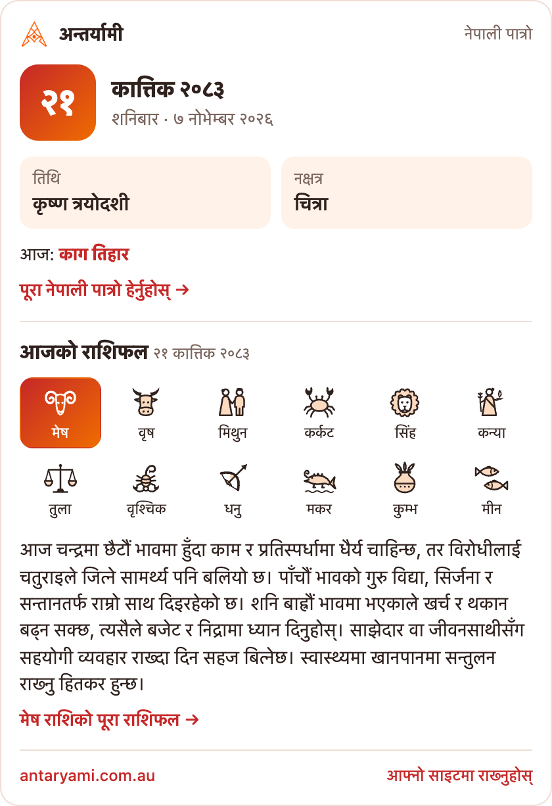
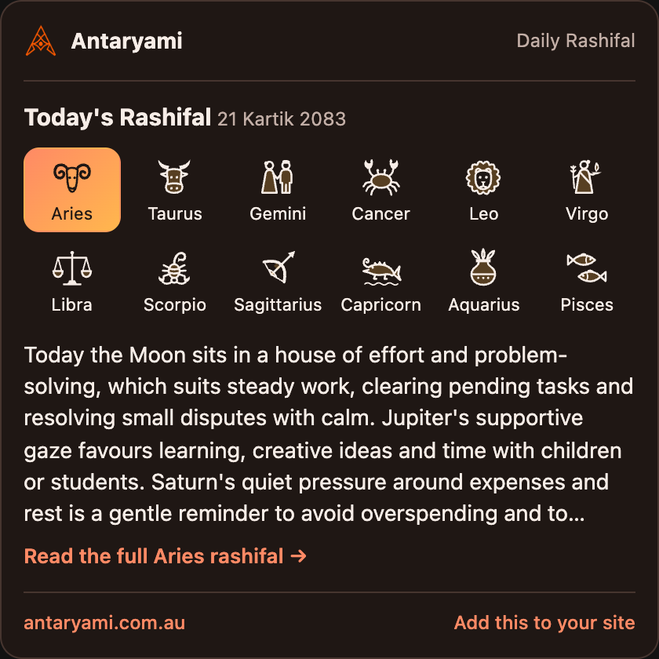
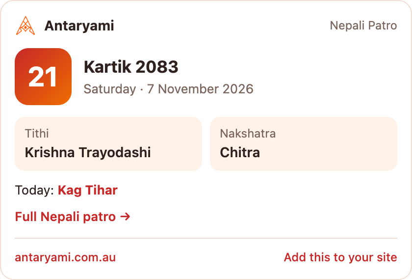

# Nepali Patro and Rashifal widget

A free widget that shows today's **Nepali date (Bikram Sambat)**, **tithi**, **nakshatra**, today's or the next **festival**, and the **daily rashifal** for all 12 rashis on any website. It's available in Nepali or English, with light or dark colours, and it updates itself every day.

Two lines of HTML. No sign-up, no API key, no cookies, no ads.

**[Pick your options and copy the code →](https://antaryami.com.au/widget)**

<p>
  
  
  
</p>

> **नेपालीमा:** आफ्नो वेबसाइटमा आजको नेपाली मिति, तिथि, नक्षत्र, चाडपर्व र दैनिक राशिफल देखाउन तलको दुई लाइन कोड टाँस्नुहोस्। निःशुल्क छ, दर्ता चाहिँदैन, र यो हरेक दिन आफैं अपडेट हुन्छ। विकल्प छानेर कोड कपी गर्न: [antaryami.com.au/widget](https://antaryami.com.au/widget)

It's made for Nepali community associations, temples, restaurants, shops, news sites and blogs.

## Quick start

Paste this where you want the widget to appear:

```html
<a class="antaryami-widget" href="https://antaryami.com.au/patro">नेपाली पात्रो र राशिफल — अन्तर्यामी</a>
<script async src="https://antaryami.com.au/widget.js"></script>
```

The script draws the widget just above the link. The link stays on your page as a small credit line. Please keep it: it's the only thing we ask in return.

## Options

Set options as `data-` attributes on the link:

| Attribute    | Values                               | Default |
|--------------|--------------------------------------|---------|
| `data-type`  | `both`, `patro`, `rashifal`          | `both`  |
| `data-lang`  | `ne` (Nepali), `en` (English)        | `ne`    |
| `data-theme` | `light`, `dark`                      | `light` |
| `data-sign`  | the rashi the rashifal opens on: `mesha`, `vrishabha`, `mithuna`, `karka`, `simha`, `kanya`, `tula`, `vrishchika`, `dhanu`, `makara`, `kumbha`, `meena` | `mesha` |

For example, here is the rashifal only, in English, dark, opening on Simha (Leo):

```html
<a class="antaryami-widget" href="https://antaryami.com.au/rashifal"
   data-type="rashifal" data-lang="en" data-theme="dark" data-sign="simha">Today's Rashifal by Antaryami</a>
<script async src="https://antaryami.com.au/widget.js"></script>
```

You can put several widgets on one page. Load the script once.

The widget is up to 420px wide and shrinks to fit narrower columns, down to 280px. Its height adjusts to its content.

## If your site doesn't allow scripts

WordPress.com, Wix, Weebly and some page builders strip `<script>` tags. Use an iframe instead:

```html
<iframe src="https://antaryami.com.au/embed" title="Nepali Patro and Rashifal"
        style="width:100%;max-width:420px;height:600px;border:0" loading="lazy"></iframe>
<p><a href="https://antaryami.com.au/patro">नेपाली पात्रो र राशिफल — अन्तर्यामी</a></p>
```

The options become URL parameters, such as `https://antaryami.com.au/embed?type=rashifal&lang=en&theme=dark&sign=simha`. Recommended heights are `600` for `both`, `300` for `patro` and `400` for `rashifal`. The iframe can't resize itself without the script.

## Where to paste it

- **WordPress:** a "Custom HTML" block, or a Custom HTML widget in the sidebar.
- **WordPress.com, Wix, Weebly:** the iframe version, in an Embed or HTML block.
- **Squarespace:** a Code block.
- **Blogger:** Layout → Add a Gadget → HTML/JavaScript.
- **Google Sites:** Insert → Embed → Embed code.

## React, Vue, Next.js

The script looks for widget links when the page loads. If your app renders the link later, for example after a client-side route change, call `window.AntaryamiWidget.scan()` once the link is in the page:

```jsx
import { useEffect } from 'react';

export function NepaliPatro() {
  useEffect(() => {
    if (window.AntaryamiWidget) {
      window.AntaryamiWidget.scan();
      return;
    }
    const s = document.createElement('script');
    s.src = 'https://antaryami.com.au/widget.js';
    s.async = true;
    document.body.appendChild(s);
  }, []);

  return (
    <a className="antaryami-widget" href="https://antaryami.com.au/patro" data-lang="en">
      Nepali Patro by Antaryami
    </a>
  );
}
```

Calling `scan()` again is safe, because each link is only turned into a widget once.

## Self-hosting the script

`widget.js` in this repository is the same file as `https://antaryami.com.au/widget.js`. You can serve it yourself, or pin a version from jsDelivr:

```html
<script async src="https://cdn.jsdelivr.net/gh/prakasbhattarai-web/nepali-patro-widget@1/widget.js"></script>
```

The widget's content still comes from antaryami.com.au, because the script only adds an iframe. Loading the script from antaryami.com.au gets you fixes as soon as they ship.

## What the widget shows

- **Date:** today in Nepal (Asia/Kathmandu), in Bikram Sambat and in the Gregorian calendar.
- **Tithi and nakshatra:** the Kathmandu panchang at sunrise, as a printed Nepali patro shows it. So visitors anywhere in the world see the same day as their family in Nepal.
- **Festival:** today's festival, tomorrow's, or the next one coming up.
- **Rashifal:** the day's reading for each of the 12 rashis, written in Nepali and English by [Antaryami](https://antaryami.com.au/rashifal).

## Privacy

The widget runs in its own frame on antaryami.com.au, so it can't read your page. It doesn't set cookies, and it doesn't track your visitors across sites. The links inside it carry a `utm_source=widget` tag, so we can see which sites send visitors.

## Questions and requests

Open an [issue](https://github.com/prakasbhattarai-web/nepali-patro-widget/issues) or write to us through [antaryami.com.au/contact](https://antaryami.com.au/contact). If you've added the widget to your site, tell us and we'll list you.

## License

[MIT](LICENSE) for the code in this repository. The calendar, panchang and rashifal content the widget displays is provided free by [Antaryami](https://antaryami.com.au) for embedding with the credit link.
